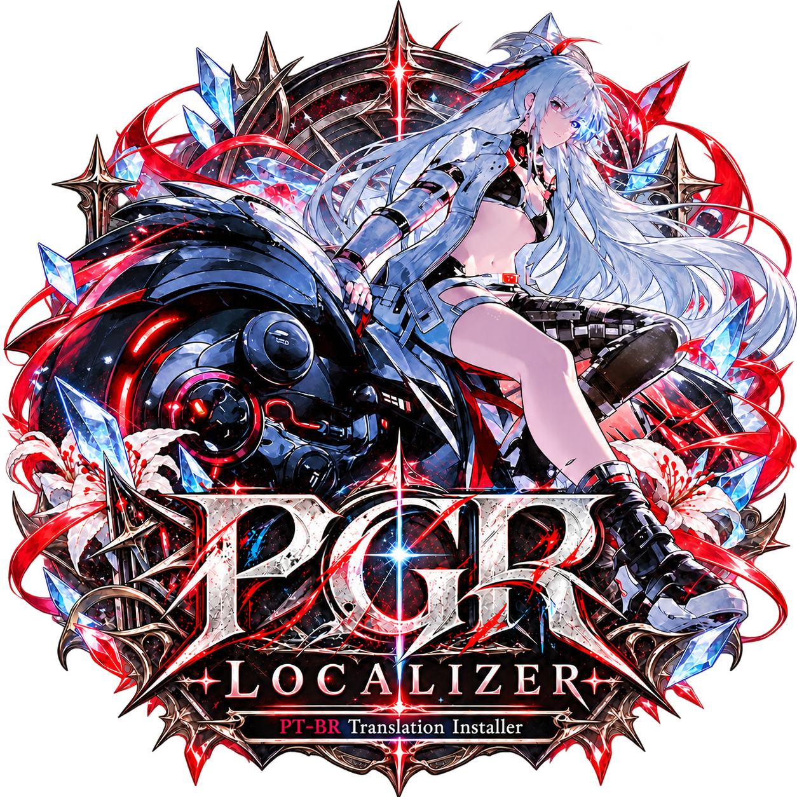
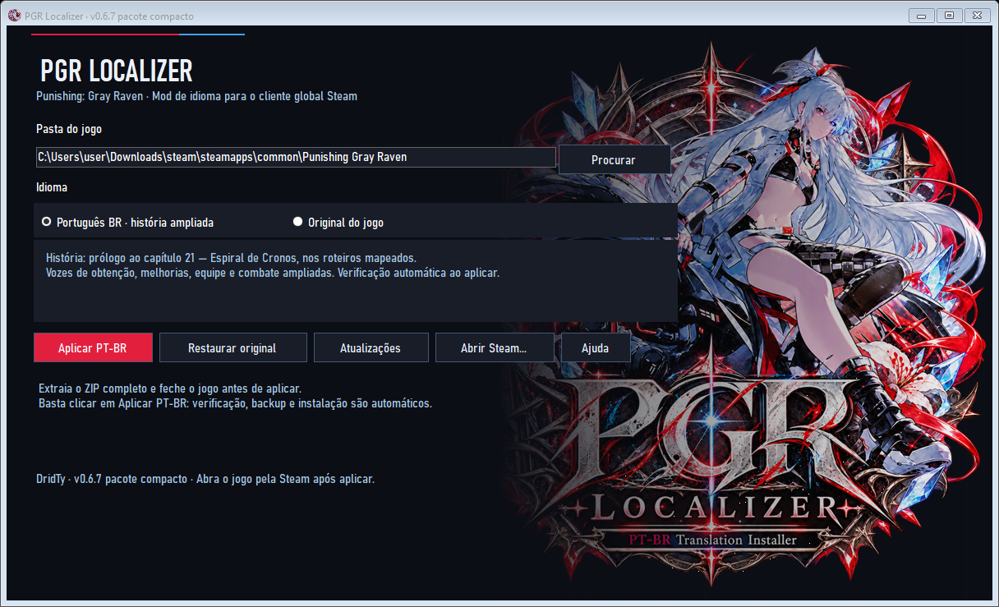

  

<h1 align="center">PGR Localizer 🇧🇷</h1>

  <strong>TRADUÇÃO COMUNITÁRIA · PORTUGUÊS BRASILEIRO · WINDOWS · STEAM GLOBAL</strong>

  
  
  

  <a href="https://github.com/DridTy/PGR-Traducao-PT-BR/releases/latest"><strong>⬇ BAIXAR A TRADUÇÃO — ZIP COMPLETO</strong></a>
  &nbsp;•&nbsp;
  <a href="https://github.com/DridTy/PGR-Traducao-PT-BR/releases">📦 TODAS AS VERSÕES</a>
  &nbsp;•&nbsp;
  <a href="https://github.com/DridTy/PGR-Traducao-PT-BR/issues">💬 RELATAR UM PROBLEMA</a>

---

**Punishing: Gray Raven em português brasileiro, diretamente dentro do jogo.**

> **Preparação do primeiro lançamento:** a apresentação do projeto já está disponível. O botão de download passará a funcionar assim que o pacote completo for publicado na seção de versões.

O **PGR Localizer** é um instalador comunitário desenvolvido por **DridTy** para aplicar a tradução ao cliente global da Steam. O projeto abrange história, menus, descrições e interações dos personagens, com expansão e revisão contínuas.

A tradução é aplicada aos arquivos locais do jogo. Não depende de reconhecimento de imagem nem de tradução em tempo real. **As vozes permanecem originais.**

## 📖 Até onde a história está traduzida?

| Conteúdo | Cobertura desta primeira versão |
| :--- | :--- |
| Prólogo e história principal | Roteiros mapeados do prólogo e dos capítulos **1 a 21** |
| Último capítulo incluído | **21 — Espiral de Cronos** |
| Saudações e afinidade | Cobertura ampliada das falas dos personagens |
| Interações e obtenção | Falas de toque, ociosidade, entrada do Constructo e outras interações |
| Evolução e equipe | Falas de melhorias, equipamentos, formação e liderança com cobertura ampliada |
| Missões e combate | Falas durante missões e de missão concluída com cobertura ampliada |
| Interface e descrições | Menus, perfis resumidos, carregamentos e descrições selecionadas |
| Capítulos 22 em diante | Ainda fora da cobertura anunciada |

**O capítulo 21 inclui seu último roteiro narrativo mapeado.** Isso não significa que todos os recursos associados a esses capítulos estejam traduzidos: vídeos, imagens com texto e algumas falas durante as missões podem continuar no idioma original.

> **Tradução parcial em desenvolvimento.** Há textos produzidos com auxílio de tradução automática e ainda sujeitos a revisão. Eventos, histórias secundárias, perfis extensos e outros conteúdos não estão integralmente cobertos. Podem ocorrer termos inconsistentes, frases pouco naturais ou textos que ultrapassem o espaço da interface.

## 🖥️ Conheça o instalador

  

- **Aplicar PT-BR:** verifica a compatibilidade, cria o backup e aplica a tradução em um único fluxo.
- **Restaurar original:** recupera os arquivos originais preservados no backup.
- **Atualizações:** consulta as novas versões publicadas no GitHub e oferece acesso à página de download.
- **Abrir Steam:** facilita o acesso à plataforma para iniciar o jogo.

O pacote completo contém os recursos necessários à instalação, inclusive os arquivos adicionais que o instalador precisa criar. **Não depende de uma versão anterior da tradução.**

## 🚀 Como instalar

1. Atualize o **Punishing: Gray Raven** pela Steam.
2. Abra o jogo e aguarde a conclusão do download dos recursos internos.
3. **Feche o jogo.**
4. Baixe o **ZIP completo** anexado à [versão mais recente](https://github.com/DridTy/PGR-Traducao-PT-BR/releases/latest).
5. Extraia **todo o conteúdo** para uma pasta nova.
6. Execute o instalador do **PGR Localizer** e selecione a pasta que contém `PGR.exe`.
7. Clique em **Aplicar PT-BR** e aguarde a confirmação.
8. Abra o jogo pela **Steam**, mantendo o idioma do cliente em **inglês** para utilizar os recursos substituídos pela tradução.

**Não é necessário clicar em Verificar antes de aplicar:** a verificação já faz parte do processo de instalação.

> Baixe o **pacote completo da tradução** anexado ao lançamento. Os arquivos de código-fonte gerados automaticamente pelo GitHub não são o instalador.

Mantenha o executável, o manifesto, as artes e a pasta `payload/` juntos, conforme extraídos do ZIP. Não execute o programa diretamente de dentro do arquivo compactado.

## 📋 Requisitos

- **Windows** com .NET Framework compatível com o instalador.
- Cliente **global da Steam** instalado, atualizado e com os recursos internos baixados.
- Espaço livre para os arquivos da tradução e o backup dos originais.

Não exige Python nem ferramentas de desenvolvimento. O instalador não baixa o jogo e não solicita sua senha ou seus dados de login.

## 🔄 Como atualizar a tradução

1. Abra o instalador e clique em **Atualizações**.
2. Se houver uma versão nova, utilize **Baixar v…** para abrir a página correspondente no GitHub.
3. Baixe o novo **ZIP completo** e extraia tudo em outra pasta.
4. Com o jogo fechado, execute o novo instalador e clique em **Aplicar PT-BR**.

A consulta usa os lançamentos públicos deste repositório. **O download e a instalação são manuais.** Uma falha de conexão não impede o uso local do instalador.

## ↩️ Como restaurar o jogo

Com o jogo fechado, abra o instalador, selecione a pasta correta e clique em **Restaurar original**.

**Preserve o backup criado pelo instalador enquanto a tradução estiver instalada.** Ele contém os arquivos originais da sua instalação e é usado na restauração.

## 🛠️ E quando o jogo atualizar?

Atualizações do PGR podem substituir os arquivos traduzidos ou alterar a estrutura dos recursos. Nesses casos, pode ser necessário baixar uma nova versão da tradução.

Se o instalador informar incompatibilidade, confira se o jogo terminou de baixar os recursos e consulte os [lançamentos do projeto](https://github.com/DridTy/PGR-Traducao-PT-BR/releases). A verificação de compatibilidade evita aplicar o pacote a recursos que ele não reconhece.

## 💬 Encontrou algum problema?

Abra um [relato no GitHub](https://github.com/DridTy/PGR-Traducao-PT-BR/issues) e, quando possível, informe:

- A versão do instalador e a mensagem exibida.
- O capítulo, a missão, o personagem ou o menu afetado.
- Uma captura da tela ou a frase exata que precisa de correção.
- Se o problema ocorreu na primeira instalação, após atualizar a tradução ou após atualizar o jogo.

Sugestões de tradução e correções de termos também são bem-vindas.

## ❤️ Créditos

**Projeto e identidade visual:** [DridTy](https://github.com/DridTy).

O projeto de tradução russa foi utilizado como referência técnica para o estudo dos recursos do jogo. A tradução narrativa e as interações deste projeto partiram dos textos em inglês.

Obrigado a todos que testam, enviam capturas e ajudam a melhorar a tradução.

---

  <strong>Projeto comunitário, independente e não oficial.</strong> 
  Punishing: Gray Raven, seus personagens e recursos originais pertencem aos respectivos titulares. 
  Este projeto não possui vínculo oficial com a Kuro Games.

  <a href="https://github.com/DridTy/PGR-Traducao-PT-BR/releases/latest">⬇ Baixar tradução</a>
  &nbsp;•&nbsp;
  <a href="https://github.com/DridTy/PGR-Traducao-PT-BR/releases">📦 Histórico de versões</a>
  &nbsp;•&nbsp;
  <a href="https://github.com/DridTy/PGR-Traducao-PT-BR/issues">💬 Enviar uma correção</a>

