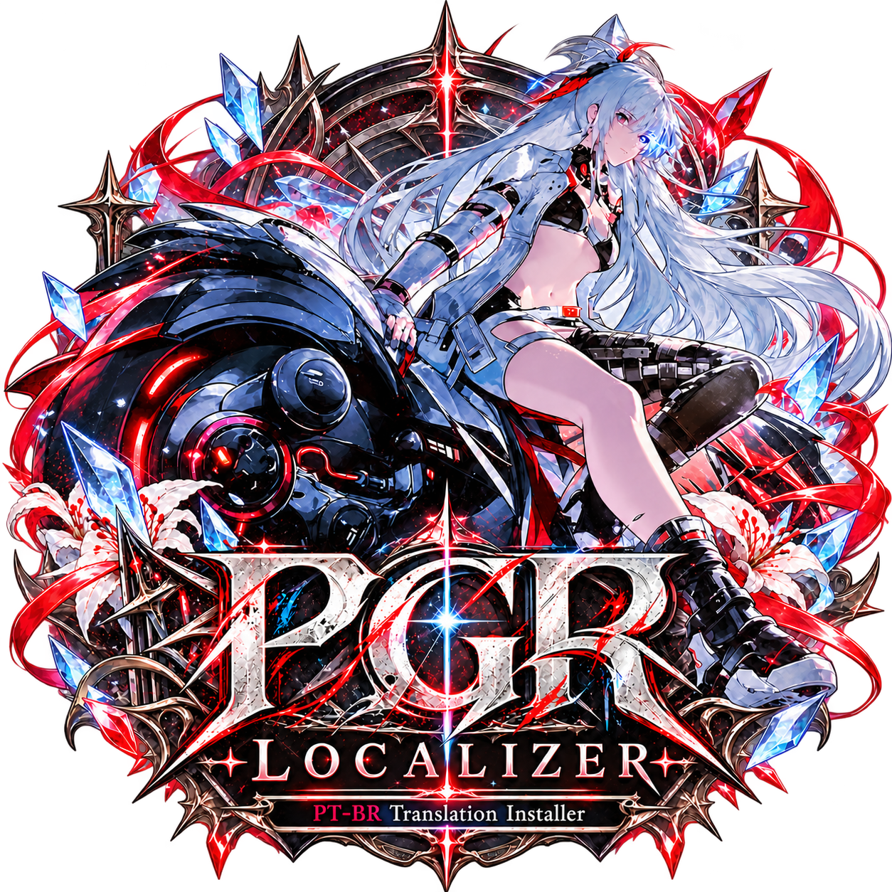
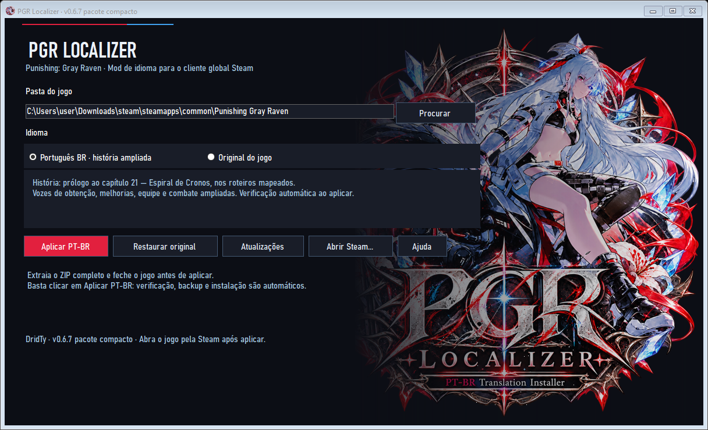

  

<h1 align="center">PGR Localizer 🇧🇷</h1>

  <strong>TRADUÇÃO LIVRE E GRATUITA   · PORTUGUÊS BRASILEIRO · WINDOWS · STEAM GLOBAL</strong>

  
  
  

  <a href="https://github.com/DridTy/PGR-Traducao-PT-BR/releases/latest"><strong>⬇ BAIXAR A TRADUÇÃO — ZIP COMPLETO</strong></a>
  &nbsp;•&nbsp;
  <a href="https://github.com/DridTy/PGR-Traducao-PT-BR/releases">📦 TODAS AS VERSÕES</a>
  &nbsp;•&nbsp;
  <a href="https://github.com/DridTy/PGR-Traducao-PT-BR/issues">💬 RELATAR UM PROBLEMA</a>

---

**Punishing: Gray Raven em português brasileiro, diretamente dentro do jogo.**

O **PGR Localizer** é um instalador desenvolvido por **DridTy**. Ele aplica a tradução aos arquivos locais do cliente global da Steam. **As vozes e os vídeos permanecem originais.**

A **1.0 Beta 4** acrescenta legendas para 11 cenas de Lembranças, incluindo **Brilho Residual (Afterglow)**, **Estrelas e Bolhas** e as três **Cortinas**. Também traduz a aba **Quadrinhos Animados**, títulos selecionados e os botões e avisos do reprodutor.

## 📖 O que está traduzido?

| Conteúdo | Cobertura da 1.0 Beta 4 |
| :--- | :--- |
| Prólogo e história principal | Roteiros mapeados até o **capítulo 44**, incluindo a revisão da abertura desse capítulo |
| Histórias extras | EX, ER, histórias ocultas e interlúdios mapeados |
| Eventos e crossovers | Roteiros mapeados de **85 entradas** do Códice |
| Afinidade e personagens | Histórias de afinidade, incluindo **Leia: Fortunaster**, além de saudações, interações e outras falas selecionadas |
| Interface e missões | Menus, descrições, perfis resumidos, falas e objetivos selecionados |
| Lembranças e cutscenes | **83 cenas** com legendas PT-BR separadas |

> **Tradução em desenvolvimento, com revisão parcial.** Parte dos diálogos foi traduzida com auxílio de tradução automática. Ainda há falas, menus, cenas e artes em inglês. Nas cenas em que o inglês faz parte da imagem, a legenda em português aparece junto à original.

## 🖥️ Conheça o instalador

  

O launcher da série **1.0 Beta** usa a arte completa como fundo, com painéis translúcidos. No instalador da beta:

- **Aplicar tradução** confere a compatibilidade, cria o backup e instala o pacote.
- **Restaurar original** recupera os arquivos originais pelo backup.
- **Atualizações** consulta lançamentos públicos estáveis e beta.
- **Abrir PGR** inicia o jogo pela Steam.

## 🚀 Como instalar

1. Confira se a sua versão do jogo corresponde à indicada no lançamento. A **1.0 Beta 4** foi testada com o cliente global **Steam 4.9.1**, build **26260993**.
2. Conclua o download dos recursos internos do jogo e **feche o PGR**.
3. Baixe o **ZIP completo** anexado à [versão mais recente](https://github.com/DridTy/PGR-Traducao-PT-BR/releases/latest). Para encontrar a 1.0 Beta 4 caso ela esteja marcada como pré-lançamento, abra **Todas as versões** no topo.
4. Extraia **todo o conteúdo** do ZIP para uma pasta nova, fora da instalação do jogo. Escolha o ZIP da tradução entre os anexos do lançamento. Os arquivos chamados **Source code** são gerados pelo GitHub.
5. Abra o PGR Localizer e selecione a pasta que contém `PGR.exe`.
6. Clique em **Aplicar tradução** e aguarde a confirmação. A verificação de compatibilidade é automática.
7. Abra o jogo pela **Steam**, mantendo o idioma do cliente em **inglês** para usar os recursos substituídos pela tradução.

Mantenha o executável, o manifesto, a pasta `assets/` e a pasta `payload/` juntos após extrair o ZIP. O pacote funciona em instalação limpa.

## 📋 Requisitos

- Windows com .NET Framework compatível com o instalador.
- Cliente global do PGR pela Steam, na versão indicada no lançamento, com os recursos internos baixados.
- Espaço livre para os arquivos da tradução e o backup dos originais.

## 🔄 Como atualizar a tradução

1. Abra o instalador da beta e clique em **Atualizações**.
2. Se houver uma versão nova, clique em **Ver lançamento** para abrir a página no GitHub.
3. Baixe e extraia o novo **ZIP completo** em outra pasta.
4. Com o jogo fechado, execute o novo instalador e clique em **Aplicar tradução**.

O download e a instalação são manuais. A migração direta da **Beta 3** para a **Beta 4**, a instalação limpa e a restauração foram testadas em uma cópia isolada do jogo.

## ↩️ Como restaurar o jogo

Com o PGR fechado, abra o instalador, selecione a pasta do jogo e clique em **Restaurar original**. **Preserve o backup criado pelo instalador** enquanto a tradução estiver aplicada.

## 🛠️ E quando o jogo atualizar?

Uma atualização do PGR pode substituir os arquivos traduzidos ou alterar a estrutura dos recursos. Se o instalador informar incompatibilidade, confira se o jogo terminou de baixar os recursos e consulte os [lançamentos do projeto](https://github.com/DridTy/PGR-Traducao-PT-BR/releases) para encontrar uma versão compatível.

## 💬 Encontrou algum problema?

Ao abrir um relato, inclua o máximo possível destas informações. [Relatar no GitHub](https://github.com/DridTy/PGR-Traducao-PT-BR/issues)

- Versão do instalador e mensagem exibida.
- Capítulo, missão, personagem, menu ou nome da cena em Lembranças.
- Uma captura da tela ou a frase exata.
- Se ocorreu na primeira instalação, após atualizar a tradução ou após atualizar o jogo.

Sugestões de tradução e correções de termos também são bem-vindas.

## ❤️ Créditos

Projeto e identidade visual por [DridTy](https://github.com/DridTy).

O projeto de tradução russa serviu de referência técnica para estudar os recursos do jogo. A tradução narrativa e as interações partiram dos textos em inglês.

Obrigado a todos que testam, enviam capturas e ajudam a melhorar a tradução.

---

  <strong>Projeto comunitário, independente e não oficial.</strong> 
  Punishing: Gray Raven, seus personagens e recursos originais pertencem aos respectivos titulares. 
  Este projeto não possui vínculo oficial com a Kuro Games.

  <a href="https://github.com/DridTy/PGR-Traducao-PT-BR/releases/latest">⬇ Baixar tradução</a>
  &nbsp;•&nbsp;
  <a href="https://github.com/DridTy/PGR-Traducao-PT-BR/releases">📦 Histórico de versões</a>
  &nbsp;•&nbsp;
  <a href="https://github.com/DridTy/PGR-Traducao-PT-BR/issues">💬 Enviar uma correção</a>

